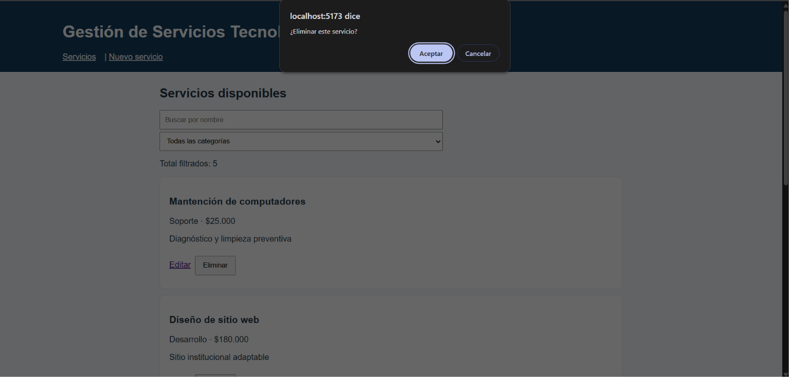

# Actividad 13: CRUD con Vue 3 y API REST - Gestión de Servicios Tecnológicos

**Estudiante:** Camilo Felipe Rodriguez Saldana

## Objetivo
Construir una aplicación web SPA (Single Page Application) que permita registrar, consultar, editar y eliminar servicios tecnológicos. El proyecto integra Vue 3, Vue Router para la navegación, Fetch para el consumo de datos y una API REST local simulada mediante JSON Server.

## Requisitos
Para ejecutar este proyecto es necesario contar con:
* **Node.js y npm** instalados en el sistema.
* Un navegador web moderno (Chrome, Edge, Firefox).
* Git para el control de versiones.

## Instalación
1. Clonar este repositorio en tu máquina local:
   ```bash
   git clone URL_DE_TU_REPOSITORIO

2. Ingresar a la carpeta del proyecto: 
    cd gestion-servicios

3. Instalar las dependencias principales del proyecto (Vue, Vue Router, etc.):
    npm install 

4. Asegurarse de tener instalado JSON Server para la API local:
    npm install -D json-server

## Ejecutar ambas terminales
Para que la aplicacion funcione debemos levantar tanto el servidor de base de datos como el servidor de desarrollo frontend.

- Terminal 1: Servidor de datos
Abre una terminal en la raíz del proyecto y ejecuta:
    **npx json-server db.json --port 3001**

- Terminal 2: Servidor Frontend:
Abre una segunda terminal en la raíz del proyecto y ejecuta:
    **npm run dev**
Abre el enlace local que te entregue la consola, generalmente http://localhost:5173.

## Funcionalidades
- Listado de Servicios: Obtención de datos mediante método GET a la API REST.
- Filtros de Búsqueda: Búsqueda dinámica por nombre y filtro por categoría.
- Creación (POST): Formulario con validación básica para registrar nuevos servicios en la base de datos (se han agregado servicios propios como "Ensamblaje de PC" y "Auditoría de Seguridad Web").
- Edición (PUT): Carga automática de los datos actuales de un servicio en el formulario para su modificación.
- Eliminación (DELETE): Borrado de registros previa alerta de confirmación.
- Diseño Responsivo (Mobile-First): Interfaz adaptada completamente a pantallas de dispositivos móviles.

## Capturas de Pantalla 
**1. Listado principal y filtros**


**2. Formulario de Creación (Nuevo Servicio)**


**3. Formulario de Edición**


**4. Confirmación de Eliminación**
